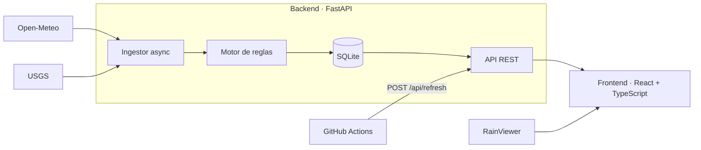

# Alertas Metereologicas

Monitoreo de amenazas climáticas y sísmicas en Chile. Consulta pronósticos y sismos de APIs gratuitas, los pasa por un motor de reglas propio y muestra las alertas en un mapa interactivo.

<!-- Cuando tengas el GIF de la demo (15 s), guárdalo como docs/demo.gif y descomenta la línea siguiente. -->
<!--  -->

**Demo:** `[URL de Vercel]` · **API:** `[URL del backend]/docs`

## Qué hace

- Vigila 19 ciudades de Arica a Punta Arenas y evalúa las próximas 24 horas cada 15 minutos.
- Detecta ráfagas fuertes, lluvia intensa, tormentas eléctricas, heladas, calor extremo y nevadas.
- Registra sismos de los últimos 7 días (M4.5+) y alerta los que ocurren cerca de una ciudad monitoreada.
- Muestra todo en un mapa oscuro con marcadores por severidad, radar de lluvia, sismos por magnitud, filtros y un pronóstico por hora con los umbrales dibujados.

Nombrarlo "sensor" sería engañoso: no hay hardware. Es un **sensor virtual**: ingiere datos de terceros, aplica reglas y emite alertas.

## Arquitectura



- **El navegador nunca llama a Open-Meteo ni a USGS.** El backend consulta cada fuente una vez cada 15 minutos y guarda el resultado. Así se respetan los límites de uso sin importar cuánta gente abra la página.
- **Las fuentes fallan por separado.** Si USGS se cae, el clima sigue actualizándose y viceversa; los datos previos se conservan y la interfaz avisa.
- **El motor de reglas es código puro** (`backend/app/rules.py`): sin red ni base de datos, por eso se testea con datos sintéticos.
- **Los umbrales viven en un solo lugar.** El frontend los lee de `GET /api/rules` para dibujar las líneas del gráfico.

## Stack

| Capa | Tecnología |
|---|---|
| Backend | Python 3.12, FastAPI, httpx (async), Pydantic, SQLite |
| Frontend | React 19, TypeScript, Vite, Tailwind CSS 4, react-leaflet, Recharts |
| Datos | Open-Meteo, USGS Earthquake Catalog, RainViewer, OpenStreetMap |
| Calidad | pytest (42 tests), `tsc` estricto, GitHub Actions |
| Despliegue | Docker, Docker Compose, Vercel (frontend), cualquier host con Docker (backend) |

## Reglas de alerta

Se evalúan las próximas 24 horas de cada ciudad. Hay a lo más una alerta por tipo y ciudad: la más severa.

| Amenaza | Amarilla | Naranja | Roja |
|---|---|---|---|
| Ráfagas de viento | ≥ 60 km/h | ≥ 75 km/h | ≥ 90 km/h |
| Lluvia | ≥ 5 mm/h | ≥ 10 mm/h | ≥ 20 mm/h |
| Tormenta eléctrica | código WMO 95 | 96 (granizo) | 99 (granizo fuerte) |
| Helada | ≤ 0 °C con humedad ≥ 60 % | ≤ -3 °C | ≤ -6 °C |
| Calor extremo | ≥ 35 °C | ≥ 38 °C | ≥ 40 °C |
| Nieve | código WMO 73 | 75 u 86 | — |
| Sismo | M ≥ 5.0 | M ≥ 6.0 | M ≥ 7.0 |

Un sismo genera alerta si ocurrió en las últimas 48 horas y a menos de 300 km de alguna ciudad monitoreada; se asocia a la más cercana.

> Los umbrales son una decisión de diseño, no una norma oficial. Se ajustan en `backend/app/rules.py`.

## Ejecutar en local

Requisitos: Python 3.12+ y Node 20+.

**Backend**

```bash
cd backend
python -m venv .venv
source .venv/bin/activate        # Windows: .venv\Scripts\activate
pip install -r requirements-dev.txt
pytest                           # 42 tests, sin red
python -m scripts.live_check     # prueba de humo contra Open-Meteo y USGS reales
uvicorn app.main:create_app --factory --reload
```

La API queda en <http://localhost:8000> y su documentación interactiva en `/docs`.

**Frontend**

```bash
cd frontend
npm install
npm run dev                      # http://localhost:5173 (redirige /api al backend)
```

**Modo demo.** La mayoría de los días no hay alertas reales, y para un GIF o una captura se necesitan. Este comando carga datos sintéticos (tormentas, heladas, un sismo M6.4) que pasan por las mismas reglas:

```bash
cd backend
python -m scripts.seed_demo
SCHEDULER_ENABLED=false uvicorn app.main:create_app --factory
# PowerShell: $env:SCHEDULER_ENABLED="false"; uvicorn app.main:create_app --factory
```

**Todo con Docker**

```bash
docker compose up --build        # http://localhost:8080
```

## API

| Método | Ruta | Descripción |
|---|---|---|
| GET | `/api/health` | Estado del servicio |
| GET | `/api/status` | Última ingesta, último error, conteos |
| GET | `/api/rules` | Umbrales vigentes |
| GET | `/api/locations` | Ciudades con condiciones actuales y severidad máxima |
| GET | `/api/alerts?min_severity=orange&kind=wind` | Alertas activas, filtrables |
| GET | `/api/quakes` | Sismos recientes |
| GET | `/api/forecast/{id}` | Pronóstico horario y alertas de una ciudad |
| POST | `/api/refresh` | Fuerza una ingesta. Exige el header `X-Refresh-Token` |

## Despliegue

1. **Backend.** Cualquier servicio que ejecute Docker (Render, Railway, Fly.io). Directorio `backend`, variables de `backend/.env.example`. Define `REFRESH_TOKEN` y agrega la URL del frontend a `CORS_ORIGINS`.
2. **Frontend en Vercel.** Directorio raíz `frontend`, variable `VITE_API_URL` con la URL del backend, sin barra final.
3. **Datos frescos con el plan gratuito.** Estos planes duermen el servicio por inactividad y, al dormir, el ingestor interno se detiene. El workflow `refresh.yml` llama a `/api/refresh` cada 15 minutos: despierta el servicio y dispara la ingesta. Agrega los secretos `BACKEND_URL` y `REFRESH_TOKEN` en GitHub. GitHub desactiva los workflows programados tras 60 días sin actividad en el repositorio.

El disco de los planes gratuitos suele ser efímero. No importa: todo lo guardado se recalcula desde las APIs en la próxima ingesta.

## Decisiones de diseño

- **SQLite con JSON en vez de un esquema relacional completo.** Los datos son una foto del momento y se reemplazan completos en cada ingesta; no hay historial que consultar. Migrar a PostgreSQL implica cambiar `db.py` y nada más.
- **Una petición por fuente, no una por ciudad.** Open-Meteo acepta varias coordenadas; las 19 ciudades salen en una sola llamada.
- **Las horas se comparan como texto.** Open-Meteo con `timezone=auto` entrega hora local de cada ciudad. Comparar `"2026-10-15T14:00"` contra el instante actual de esa misma ciudad evita convertir zonas horarias.
- **Radar con un solo fotograma.** La API gratuita de RainViewer limita a 100 peticiones por minuto por IP y a zoom 7. Animar 12 fotogramas consumiría ese cupo en la primera carga.

## Limitaciones

- Las alertas son informativas y se basan en pronósticos de modelos numéricos. **No reemplazan** los avisos de [SENAPRED](https://senapred.cl), la [Dirección Meteorológica de Chile](https://www.meteochile.gob.cl) ni el [Centro Sismológico Nacional](https://www.sismologia.cl).
- No hay historial de alertas ni notificaciones.
- Cobertura de Chile continental. Isla de Pascua, Juan Fernández y la Antártica quedan fuera.

## Siguientes pasos

- Historial de alertas y vista de línea de tiempo.
- Notificaciones por Telegram o correo al cruzar un umbral.
- Sensor físico (ESP32 con temperatura y humedad por MQTT) alimentando el mismo panel.
- Animación del radar si se migra a una fuente con más cupo.

## Datos y atribución

Datos meteorológicos de [Open-Meteo](https://open-meteo.com/) (CC BY 4.0, uso gratuito no comercial), sismos del [USGS](https://earthquake.usgs.gov/) (dominio público), radar de [RainViewer](https://www.rainviewer.com/) (uso personal y educativo), mapa base de [OpenStreetMap](https://www.openstreetmap.org/copyright). Si el proyecto llegara a monetizarse, revisa los términos de cada proveedor.

El mapa base usa las teselas públicas de OpenStreetMap, aptas para un proyecto de portafolio con poco tráfico ([política de uso](https://operations.osmfoundation.org/policies/tiles/)). Si esperas mucho tráfico, define `VITE_TILE_URL` con un proveedor de teselas con clave gratuita (MapTiler, Stadia, Jawg); ver `frontend/.env.example`.

## Licencia

MIT. Ver [LICENSE](LICENSE).
